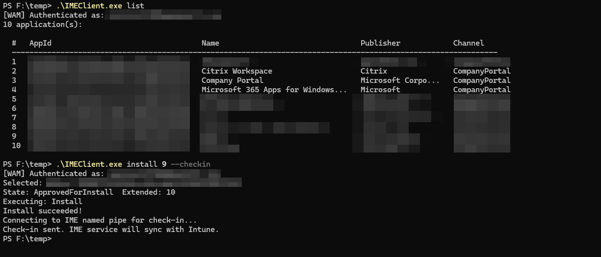

# IMEClient

Command line client for Company Portal - allows you to list, install and uninstall apps via Intune, mimicking the functionality from the Company Portal app.

## Demo

## Privilege Escalation

This can be used for privilege escalation via known race-condition and TOCTOU vulnerabilities in installer packagers.

The following example shows a known vulnerable installer packager (NSIS):

[Watch demo](https://vimeo.com/1233705055)